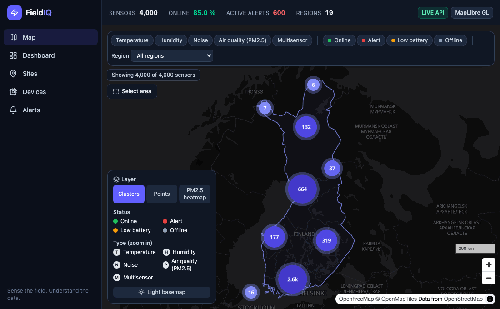
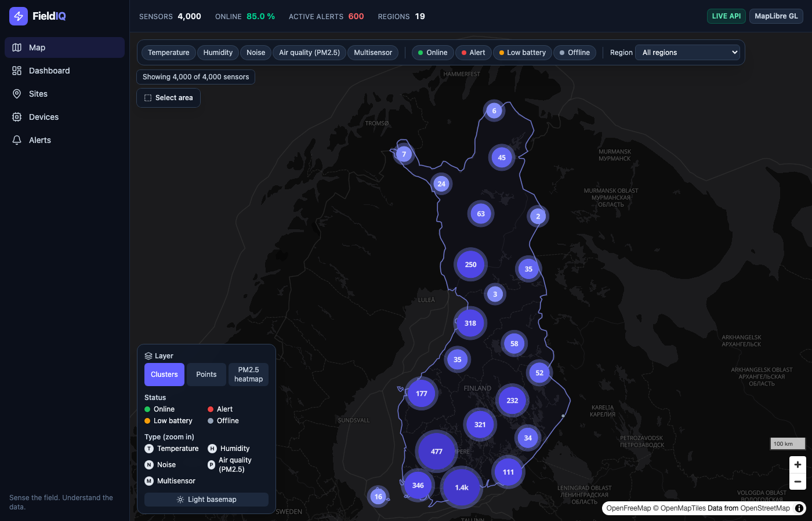
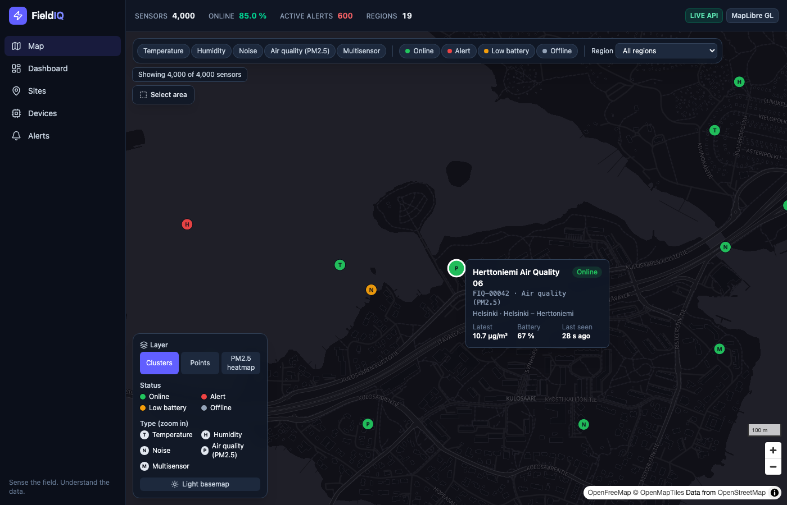
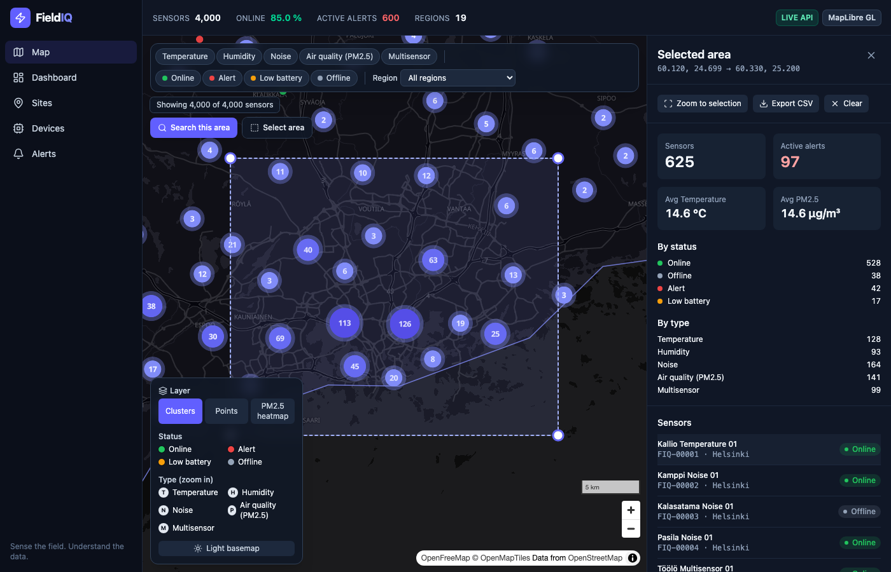
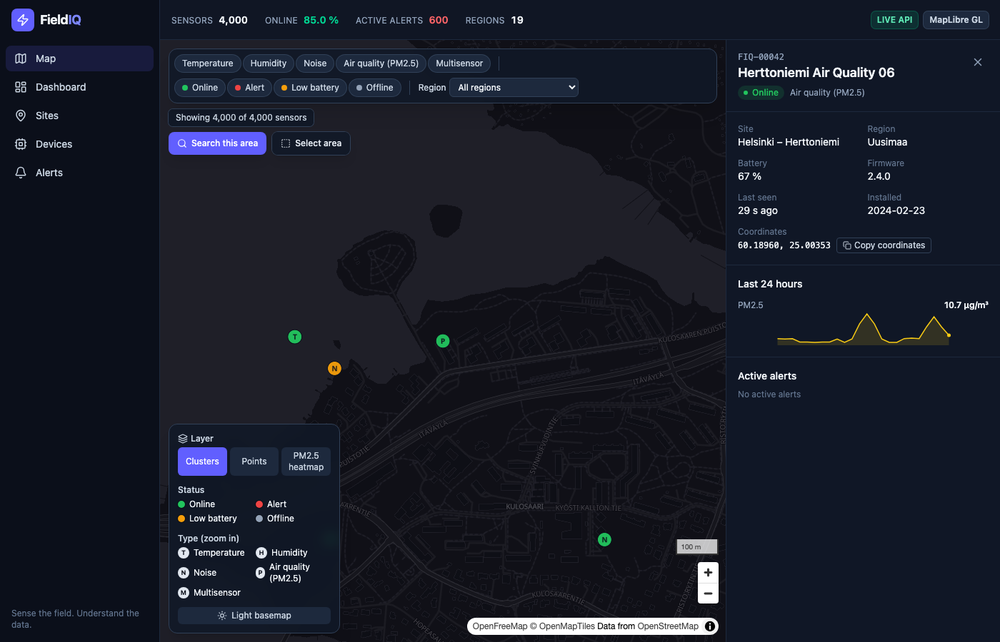
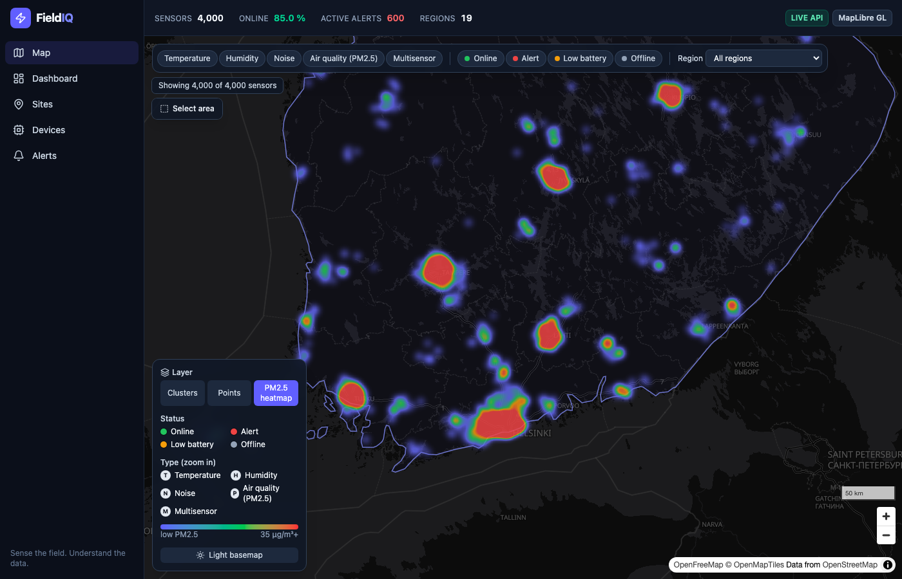
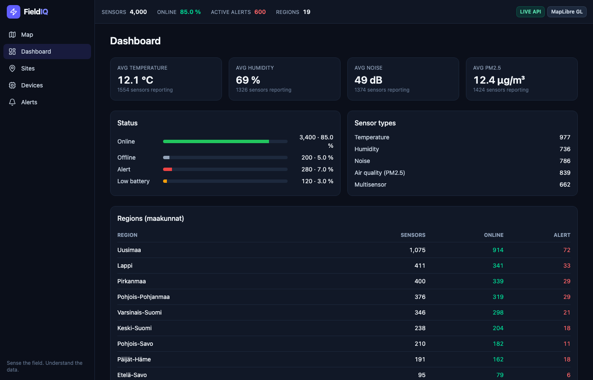
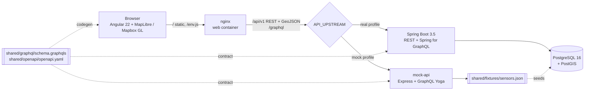

# FieldIQ

[](https://fieldiq-web-rosy.vercel.app/map)
[](https://github.com/weblinkify/field-iq-map/actions/workflows/ci.yml)

**🗺️ Live demo (mock API): <https://fieldiq-web-rosy.vercel.app/map>**. Try [a sensor deep link](https://fieldiq-web-rosy.vercel.app/map?sensor=FIQ-00042) or [Helsinki stats](https://fieldiq-web-rosy.vercel.app/map?bbox=24.7,60.12,25.2,60.33).

**FieldIQ** is an environmental and site monitoring platform that connects physical sensors with cloud software:

**Sensors → Data → Cloud → Dashboard → Insights**

Sensors measure 🌡️ temperature, 💧 humidity, 🔊 noise, 🌫️ air quality (PM2.5), 🔋 battery and 📍 location. FieldIQ turns those readings into maps, dashboards, alerts and, eventually, AI insights.

> 🚧 FieldIQ is an early-stage, independent learning project. Data is simulated until real hardware is connected.

---

## FieldIQ v2 — Sensor Map

FieldIQ v2 adds an Angular frontend and a Java backend, built around an interactive map of **4,000 sensors across Finland**.



| Clusters over Finland | Hover tooltip |
| --- | --- |
|  |  |
| **Bounding-box selection + stats** | **Sensor details (deep link)** |
|  |  |
| **PM2.5 heatmap** | **Dashboard** |
|  |  |

### What you can do

- See all 4,000 sensors on one map, fitted to Finland. Clusters show counts and a status breakdown, and clicking a cluster zooms in.
- Hover a sensor, or reach it with the keyboard (**N**/**P**, **Enter**), to see its id, type, status, latest value, battery and last-seen time.
- Click a sensor to open its details: 24 h charts per metric, active alerts and a "copy coordinates" button. Every sensor has a link: `/map?sensor=FIQ-00042`.
- **Select area** (or **Shift+drag**) to draw a rectangle with draggable corners. You get stats for that area, a paginated sensor list, *Zoom to selection*, *Export CSV* and *Clear*. The box is saved in the URL, so you can share it.
- Use **Search this area** to get stats for the current view.
- Filter by type, status and region. Filters apply to the map (without a refetch) and to the stats.
- Switch layers (clusters, points, PM2.5 heatmap) and basemap (dark/light). There is a legend and a scale bar.
- Header KPIs show the sensor count, online %, active alerts and regions covered. A **MOCK API** / **LIVE API** badge shows the mode, next to the active map engine.
- Dashboard, Sites, Devices and Alerts pages.

### Architecture



Both backends implement the same contract and read the same fixture, so **mock and real mode show the same 4,000 sensors**. Contract tests check this in CI.

### Quick start

You need Docker (Docker Desktop or Engine with Compose v2). It works on Apple Silicon and x86.

```bash
git clone https://github.com/weblinkify/field-iq-map && cd field-iq-map

make up-mock   # web + mock API. No setup, no secrets → http://localhost:8080
make up-real   # web + Spring Boot API + PostGIS (migrated and seeded) → http://localhost:8080
make down      # stop everything and remove volumes
```

Both modes use the **same web image**. When the container starts, it writes `/env.js` from environment variables, so switching modes needs no rebuild.

Local development without Docker for the app itself:

```bash
make install
make dev        # PostGIS in Docker + ./mvnw spring-boot:run + ng serve (http://localhost:4200)
make dev-mock   # in one terminal: mock API on :4000
cd apps/web && API_TARGET=http://localhost:4000 npm start   # in another
```

### Deploying to Vercel (mock API)

The live demo runs as two Vercel projects from this repo:

| Project | Root directory | What it is |
| --- | --- | --- |
| `fieldiq-mock-api` | `services/mock-api` | The mock API as a serverless function ([`vercel.json`](services/mock-api/vercel.json)). The shared schema and fixture are bundled at build time |
| `fieldiq-web` | `apps/web` | The static Angular build ([`vercel.json`](apps/web/vercel.json)). `/api/*` and `/graphql` are proxied to `fieldiq-mock-api`, so the browser stays same-origin |

Import each one in Vercel with the root directory above and the **Other** preset; both `vercel.json` files define the build. Pushes to `main` redeploy both. Optional env vars on `fieldiq-web`: `MAPBOX_TOKEN`, `BASEMAP`. The Spring Boot + PostGIS backend needs a container host (e.g. Fly.io, Render or Railway). To use it, point the rewrites in `apps/web/vercel.json` at that host.

### Mapbox token (optional)

Put a **public** Mapbox token in `.env` (copy `.env.example`):

```bash
MAPBOX_TOKEN=pk.eyJ...
```

| | With `MAPBOX_TOKEN=pk.*` | Without a token (default) |
| --- | --- | --- |
| Engine | Mapbox GL JS | MapLibre GL JS |
| Basemap | Mapbox `dark-v11` / `light-v11` | [OpenFreeMap](https://openfreemap.org) `dark` / `positron` (keyless, OSM data), or `BASEMAP=offline` |
| Features | identical: both run behind the same `MapEngine` interface | identical |

Secret tokens (`sk.*`) are ignored on purpose: they must never reach a browser. CI and mock mode need no token at all.

### Environment variables

| Variable | Used by | Default | Description |
| --- | --- | --- | --- |
| `API_MODE` | web | `mock` / `live` per profile | Mode badge and runtime config (`mock` or `live`/`real`) |
| `API_UPSTREAM` | web (nginx) | `http://mock-api:4000` / `http://api:8080` | Backend that nginx proxies `/api`, `/graphql`, `/graphiql` and Swagger to |
| `API_BASE_URL` | web | `/api/v1` | REST base URL as seen by the browser |
| `GRAPHQL_URL` | web | `/graphql` | GraphQL endpoint as seen by the browser |
| `MAPBOX_TOKEN` | web | *(empty)* | Public Mapbox token. Empty means MapLibre |
| `BASEMAP` | web | `openfreemap` | MapLibre basemap: `openfreemap` or `offline` (no network) |
| `NG_CONFIG` | web build | `production` | `e2e` adds the `window.__fieldiq` test hook |
| `WEB_PORT` / `API_PORT` / `MOCK_API_PORT` / `POSTGRES_PORT` | compose | `8080` / `8081` / `4000` / `5433` | Host ports |
| `POSTGRES_PASSWORD` | postgis, api | `fieldiq` | Local database password |
| `DATABASE_URL`, `DATABASE_USER`, `DATABASE_PASSWORD` | api | `jdbc:postgresql://localhost:5433/fieldiq`, `fieldiq`, `fieldiq` | JDBC connection |
| `FIELDIQ_SEED_ENABLED` | api | `true` | Seed an empty database on startup |
| `FIELDIQ_SEED_FORCE` | api | `false` | Wipe and re-seed (`make seed`) |
| `FIELDIQ_SEED_HISTORY_HOURS` | api | `24` | Hours of hourly history to seed |
| `FIELDIQ_SIMULATOR_ENABLED` / `FIELDIQ_SIMULATOR_INTERVAL` | api | `true` / `30s` | Live reading simulator |
| `PORT` | api, mock-api | `8080` / `4000` | Listen port inside the container |
| `FIELDIQ_SHARED_DIR` | mock-api | repo `shared/` | Location of the schema and fixture |

### API

All endpoints are proxied through the web container, so the browser only talks to its own origin and needs no CORS.

- **Swagger UI**: <http://localhost:8080/swagger-ui.html> (real mode). The spec is committed at [`shared/openapi/openapi.yaml`](shared/openapi/openapi.yaml).
- **GraphiQL**: <http://localhost:8080/graphiql> (both modes). The schema is at [`shared/graphql/schema.graphqls`](shared/graphql/schema.graphqls).

REST (`/api/v1`), for bulk map data:

| Endpoint | Description |
| --- | --- |
| `GET /sensors.geojson?bbox=minLon,minLat,maxLon,maxLat&type=&status=&region=` | FeatureCollection with lightweight properties (ETag/304) |
| `GET /sensors/{id}` | Sensor details + latest readings |
| `GET /sensors/{id}/readings?from=&to=&metric=` | Hourly history (default: last 24 h) |
| `GET /export/sensors.csv?bbox=...` | CSV export |
| `GET /health` | `{status, mode: live|mock}` |

Errors are RFC 7807 `application/problem+json`. For example, an invalid bbox (lon −180..180, lat −90..90, min < max) returns 400.

GraphQL, for details, stats and filtering. Stats for a bounding box:

```graphql
query {
  sensorStats(bbox: { minLon: 24.7, minLat: 60.1, maxLon: 25.25, maxLat: 60.35 }, filter: { types: [AIR_QUALITY_PM25, MULTI] }) {
    total
    activeAlerts
    byStatus { status count }
    averages { metric average unit sampleSize }
  }
}
```

Sensor details:

```graphql
query {
  sensor(id: "FIQ-00042") {
    name status municipality batteryPct lastSeenAt
    site { name sensorCount }
    latestReadings { metric value unit ts }
    readings(metric: PM25) { ts value }
    alerts(activeOnly: true) { severity message createdAt }
  }
}
```

`sensors(filter, bbox, first, after)` uses cursor pagination. `regions`, `sites(region)` and `alerts(activeOnly, first)` back the other pages.

### Testing

| What | Command | Notes |
| --- | --- | --- |
| Backend unit + integration | `make test-api` (`./mvnw verify`) | JUnit 5, AssertJ, MockMvc, GraphQlTester, Testcontainers PostGIS, Spotless, JaCoCo ≥ 80% (currently ~96%) |
| OpenAPI / GraphQL snapshots | part of `verify`; `make contract-snapshots` regenerates | CI fails if `shared/openapi/openapi.yaml` is stale |
| Frontend unit | `make test-web` | Vitest + Angular Testing Library, Apollo testing module, HttpTestingController |
| Mock API | `make test-mock` | REST + GraphQL + reading-model golden file |
| Fixture generator | `make test-shared` | 4,000 sensors, all inside Finland, deterministic |
| Contract (mock ↔ real) | `make contract` | Runs the same REST/GraphQL calls against both and compares shapes and deterministic values |
| E2E, mock mode | `make e2e-mock` | Playwright + Chromium (SwiftShader WebGL) |
| E2E, real mode | `make e2e-real` | Same suite against Spring Boot + PostGIS |
| README media | `cd e2e && npm run screenshots` | Regenerates `docs/screenshots/*` (stack running with `NG_CONFIG=e2e`) |

CI (`.github/workflows/ci.yml`) runs the shared, api, web and mock-api jobs, then a contract job and an **E2E matrix over `mock` and `real`**. On failure it uploads Playwright reports, traces and screenshots. `docker.yml` pushes multi-arch images to GHCR on `v*` tags, and Dependabot keeps Maven, npm, Docker and Actions up to date.

### Design decisions

- **REST/GeoJSON for map points, GraphQL for details and aggregates.** The map needs every point at once, in a format the GL source reads natively. One GeoJSON request is simple, caches well (ETag → 304) and compresses well. Details, 24 h histories, alerts and area statistics are small, nested and shaped by the UI, which suits GraphQL. Nested fields are batched with DataLoaders, so a page of 200 sensors costs a fixed number of SQL queries.
- **PostGIS bounding boxes.** Sensors are stored as `geometry(Point, 4326)` with a GiST index. Queries use `location && ST_MakeEnvelope(minLon, minLat, maxLon, maxLat, 4326)`, and a test asserts the index is used. Integration tests compare bbox counts against a plain in-memory point-in-rectangle check over the fixture.
- **GL layers, not DOM markers.** 4,000 DOM markers would mean 4,000 elements to lay out on every frame. Here every point, cluster, glyph, heatmap and selection is a WebGL layer, and hover uses `feature-state`, so pan and zoom stay smooth. Filters are GL expressions on unclustered layers. Clustered data is re-filtered in memory with the same predicate (unit tests prove the two agree).
- **Schema-first contracts with codegen.** `shared/graphql/schema.graphqls` is the source of truth. Spring loads it schema-first, the mock serves it, and the frontend generates typed Apollo services from it. REST types come from the exported OpenAPI spec. No API types are hand-written, and CI fails when generated code drifts.
- **Mock/real parity.** Both modes load `shared/fixtures/sensors.json`. Readings come from one deterministic model implemented in TypeScript and Java and pinned by `shared/fixtures/readings-golden.json`. Error shapes and GraphQL error classifications match. The contract suite proves it.
- **Map engine abstraction.** Components use a small `GlMap`/`MapEngine` interface. Mapbox and MapLibre implementations are lazy-loaded chunks, chosen at runtime from the token.

### Performance notes

- GeoJSON for 4,000 features is **1.56 MB raw → ~193 KB gzipped** (nginx gzip). Unchanged data costs a 304. The map refreshes every 60 s.
- Clustering (radius 50 px, up to zoom 11) keeps the low-zoom map to a few dozen circles. Per-status aggregates come from `clusterProperties`, so cluster tooltips need no extra queries.
- The MapLibre worker and map code load lazily. The initial bundle is ~138 KB transferred; MapLibre (~232 KB gzipped) loads with the map page.
- Seeding 4,000 sensors and 24 h of hourly history (~140k rows) takes ~7 s, using `COPY`.

### Project structure

```text
field-iq-map/
├── apps/web/                 # Angular 22 (standalone, signals, zoneless, Tailwind 4)
│   ├── src/app/api/          # *.graphql operations + generated GraphQL/OpenAPI types
│   ├── src/app/features/map/ # MapEngine, layers, controller, filters, bbox, stats, detail
│   └── docker/               # nginx template + env.js entrypoint
├── services/api/             # Spring Boot 3.5, Java 21, Flyway, PostGIS, REST + GraphQL
├── services/mock-api/        # Express + GraphQL Yoga, same contract, contract tests
├── shared/
│   ├── graphql/schema.graphqls
│   ├── openapi/openapi.yaml  # exported from the backend
│   ├── geo/finland.geojson   # Natural Earth 1:50m (public domain)
│   ├── fixtures/             # sensors.json (4,000) + readings-golden.json
│   └── scripts/              # deterministic generator (make fixtures)
├── e2e/                      # Playwright (mock + real) and README media
├── docs/screenshots/
├── docker-compose.yml        # profiles: mock | real
├── Makefile
└── .github/                  # CI, GHCR images, Dependabot
```

## Development roadmap

### Phase 1 — Foundation ✅
Next.js MVP, dashboard, simulated sensor data.

### Phase 2 — Data platform ✅ (v2)
Sites, devices, PostgreSQL + PostGIS, historical measurements, REST + GraphQL.

### Phase 3 — Monitoring ✅ (v2)
Alerts, area statistics, historical charts, the 4,000-sensor map.

### Phase 4 — Hardware
Connect real devices: **ESP32 → MQTT → ingestion service → PostGIS → FieldIQ**, replacing the simulator with real readings over the same contract.

```text
Sensors → ESP32 → Wi-Fi / Cellular → MQTT broker → FieldIQ ingestion → Database → FieldIQ Dashboard
```

### Phase 5 — Intelligence
AI anomaly detection on reading streams, environmental event detection, pattern analysis, predictive monitoring.

## Learning goal

```text
LEARN → BUILD → TEST → TALK TO USERS → IMPROVE → FIND A REAL PROBLEM → BUILD A BUSINESS
```

FieldIQ is an independent project with its own brand, design, code and architecture. It draws on the broader idea of environmental and industrial monitoring, but does not copy another company's proprietary technology, branding or implementation. Map data © OpenStreetMap contributors (via OpenFreeMap); the Finland boundary is from Natural Earth.

---

**FieldIQ**

> **Sense the field. Understand the data.**
